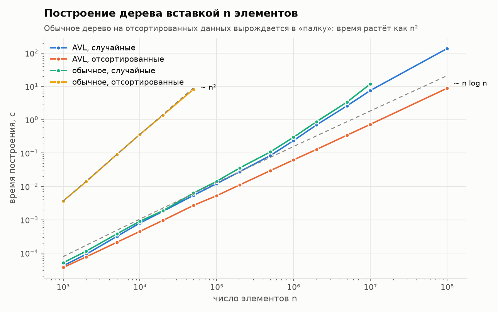
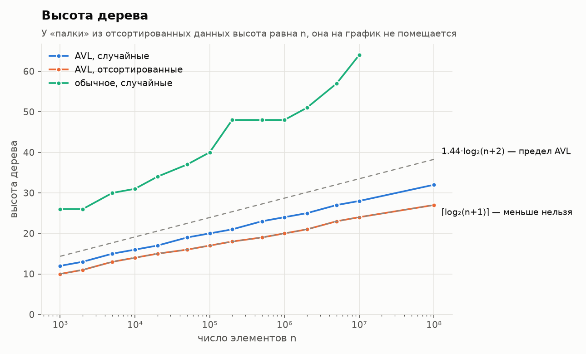
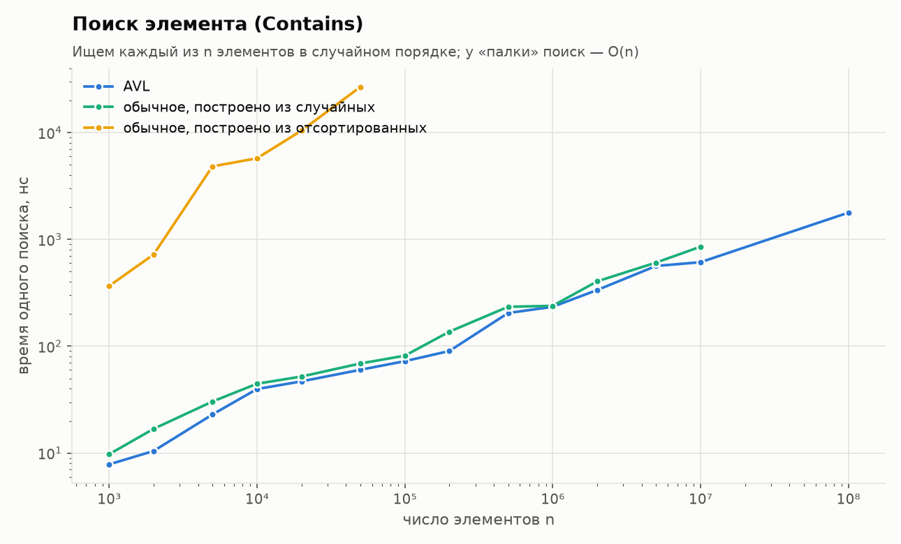
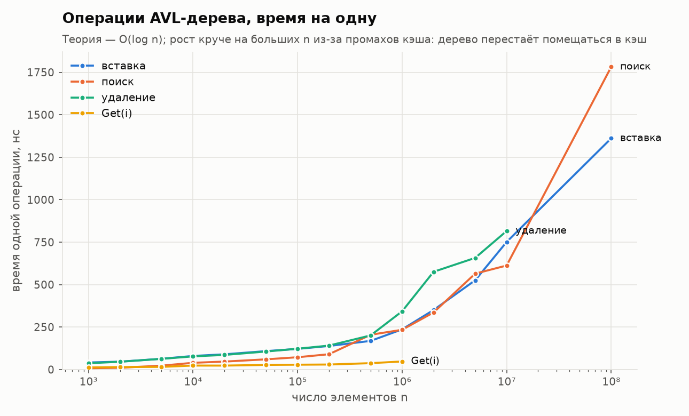
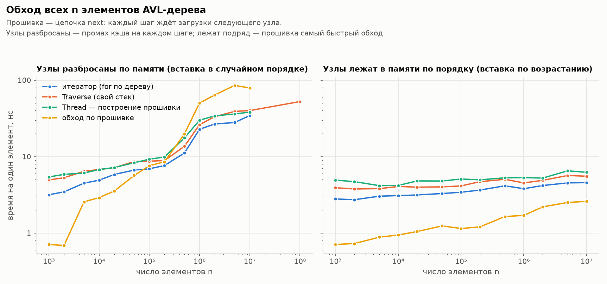

# ЛР-1 «Деревья»: бинарное дерево поиска с AVL-балансировкой

Шаблонный класс `BinarySearchTree<T>` на C++17. Он работает в двух режимах: AVL-дерево
и обычное дерево поиска без балансировки, второй нужен для сравнения. К классу прилагаются
консольный интерфейс для пяти типов элементов, 127 тестов на GoogleTest и замеры скорости
до 10⁸ элементов с графиками.

* Техническое задание — [`docs/TZ.md`](docs/TZ.md).
* Вопросы к защите с ответами — [`docs/DEFENSE.md`](docs/DEFENSE.md).

---

## 1. Выбранные пункты задания

| № | Пункт | Рейтинг | Где в коде |
|---|---|---|---|
| 1 | Бинарное дерево поиска: вставка, поиск, удаление | 5 | `Insert`, `Contains`, `Find`, `Remove` |
| 1.1 | Балансировка (AVL) | 2 | `Rebalance`, `RotateLeft`, `RotateRight` |
| 1.2 | `Map`, `Where`, `Reduce` | 3 | одноимённые методы |
| 1.3.2 | Прошивка по заданному обходу (любому из 6) | 4 | `Thread`, `TraverseThreaded`, `TraverseThreadedFrom` |
| 1.4.2 | Сохранение в строку по формату, который задаёт пользователь | 3 | `ToFormattedString`, `TreeFormat.hpp` |
| 1.5.2 | Чтение из строки по формату, который задаёт пользователь | 4 | `FromString`, `TreeParser.hpp` |
| 1.6 | Извлечение поддерева | 2 | `ExtractSubtree` |
| 1.7 | Поиск поддерева | 3 | `ContainsSubtree` |
| 7.1 | Реализация `ICollection` | 2 | `Get(i)`, `GetCount()` |
| 7.2 | Реализация `IEnumerable`, итератор | 3 | `TreeEnumerator`, `for (x : tree)` |
| 7.3 | Операторы | 2 | `+=`, `-=`, `+`, `==`, `!=`, `<<` |
| | **Итого** | **33** | минимум — 25 |

**Сверх задания:**
* порядковые статистики: `Get(i)` и `IndexOf(x)` за O(log n), для этого в узле хранится размер поддерева;
* печать дерева сверху вниз (`PrintVertical`) с подписями в UTF-8;
* обход по прошивке с любого узла (`TraverseThreadedFrom`), основа поиска по диапазону в ЛР-2;
* два режима одного дерева и их сравнение на графиках;
* реальный замер на 10⁸ элементах и измерение памяти на узел.

---

## 2. Сборка и запуск

Нужны CMake ≥ 3.25 и компилятор с C++17 (проверено на Apple clang 21).
GoogleTest скачивается сам при первом запуске `cmake`, в систему ничего не ставится.

```bash
cmake -S . -B build              # один раз: Debug + AddressSanitizer + UBSan
cmake --build build              # после каждого изменения
./build/tests                    # 127 тестов (или: ctest --test-dir build)
./build/lab1                     # консольный интерфейс
```

Код собирается со строгими предупреждениями (`-Wall -Wextra -Wpedantic -Wshadow -Wconversion
-Wsign-conversion -Wold-style-cast`) без единого предупреждения. Проверить можно так:
`cmake -S . -B build -DENABLE_WERROR=ON`, тогда любое предупреждение станет ошибкой.
Утечки проверены утилитой macOS `leaks` на тестах и на сессии меню: 0 утечек.

Замеры собираются отдельно, в Release без санитайзеров:

```bash
cmake -S . -B build-release -DCMAKE_BUILD_TYPE=Release -DENABLE_SANITIZERS=OFF
cmake --build build-release --target benchmarks
./build-release/benchmarks           # ~8 минут: results/benchmarks.csv, results/memory.csv
./build-release/benchmarks --huge    # ~6 минут и ~6 ГБ памяти: results/huge.csv (10⁸)
```

Графики рисует matplotlib, он ставится в виртуальное окружение внутри папки лабы:

```bash
python3 -m venv .venv && .venv/bin/pip install matplotlib
.venv/bin/python bench/plot.py       # results/benchmark_results/*.png
```

---

## 3. Структура проекта

```
lab1-trees/
├── CMakeLists.txt             цели: trees (библиотека из заголовков), lab1, tests, benchmarks
├── include/
│   ├── lab2_files/            свои контейнеры прошлого семестра (DynamicArray, ICollection, ...)
│   ├── tree/
│   │   ├── BinarySearchTree.hpp   главный класс
│   │   ├── Traversal.hpp          6 порядков обхода (КЛП, КПЛ, ЛКП, ЛПК, ПКЛ, ПЛК)
│   │   ├── TreeFormat.hpp         разбор строки формата вида {К}(Л)[П]
│   │   ├── TreeParser.hpp         чтение дерева из строки по формату
│   │   ├── ValueIo.hpp            значение <-> текст для int, double, string, своих типов
│   │   ├── TextCanvas.hpp         холст из символов для печати сверху вниз
│   │   └── TreeExceptions.hpp     ElementNotFound, TreeNotThreaded, TreeFormatError, TreeParseError
│   └── types/Person.hpp       Person, Student, Teacher
├── src/
│   ├── main.cpp               главное меню: выбор типа и режима
│   └── ui/                    меню дерева, безопасный ввод, свойства типов, демонстрация
├── tests/                     8 групп тестов GoogleTest
├── bench/
│   ├── benchmarks.cpp         замеры -> CSV
│   └── plot.py                CSV -> графики (matplotlib)
├── results/                   CSV замеров; графики в results/benchmark_results/
└── docs/                      ТЗ и вопросы к защите
```

**Ограничения курса:** стандартные контейнеры (`std::vector` и т.п.) не используются, везде
свои из `include/lab2_files`. Узлами владеют `std::unique_ptr`, `delete` в коде нет.

---

## 4. Интерфейс класса

От типа `T` нужны только копирование и `operator<`. Два значения считаются равными, если
`!(a < b) && !(b < a)`. Повторы не хранятся: дерево ведёт себя как множество.
h — высота дерева: у AVL h ≤ 1.44·log₂ n, у обычного дерева от log₂ n до n.

| Метод | Что делает | Сложность |
|---|---|---|
| `Insert(x)` / `Remove(x)` | вставка / удаление, `false` — если уже есть / нет | O(h) |
| `Contains(x)`, `Find(x)` | поиск; `Find` возвращает хранимое значение | O(h) |
| `GetMin()`, `GetMax()` | минимум и максимум | O(h) |
| `Get(i)`, `IndexOf(x)` | i-й по возрастанию; сколько элементов меньше x | O(h) |
| `GetCount()`, `GetHeight()` | число элементов, высота | O(1) |
| `Traverse(order, f)`, `ToArray(order)` | обход в любом из 6 порядков, без рекурсии | O(n) |
| `for (const T& x : tree)` | итератор, по возрастанию | O(n), шаг O(1) в среднем |
| `Thread(order)` | прошить дерево в порядке `order` | O(n) |
| `TraverseThreaded(f)`, `TraverseThreadedFrom(x, f)` | обход по прошивке (с начала / с x) | O(n), шаг O(1) |
| `Map(f)`, `Where(p)` | новое дерево из f(x) / из x, где p(x) истинно | O(n log n) |
| `Reduce(f, init, order)` | свёртка | O(n) |
| `ToFormattedString(format)` | сохранить в строку, например `{К}(Л)[П]` или `(Л){К}[П]` | O(n) |
| `FromString(text, format, balancing)` | прочитать и проверить BST. Без формата используется `{К}(Л)[П]` | O(n) для BST, O(n log n) для AVL при сравнении за O(1) |
| `ExtractSubtree(x)` | копия поддерева с корнем x | O(h + m) |
| `ContainsSubtree(t)` | есть ли поддерево, совпадающее с t по форме и значениям | O(h + m) |
| `Merge(t)`, `+=`, `+` | объединение множеств | O(m log(n+m)) |
| `-=` | удалить элемент | O(h) |
| `==`, `!=` | равны ли множества элементов (форма не важна) | O(n) |
| `<<` | печать `{1, 3, 5}` | O(n) |
| `PrintVertical(out, width)`, `PrintStructure(out)` | печать сверху вниз / «на боку» | O(n) / O(n·h) |
| `IsValid()` | полная проверка порядка, высот, размеров, баланса | O(n) |

**Исключения:** `ElementNotFound` (`Find`, `ExtractSubtree`), `EmptyCollection` (`GetMin`,
`GetMax` на пустом дереве), `IndexOutOfRange` (`Get`), `TreeNotThreaded` (обход по прошивке
без `Thread`), `TreeFormatError` (неверный формат), `TreeParseError` (неверная строка дерева,
с номером позиции).

---

## 5. Консольный интерфейс

`./build/lab1`: выбор типа элементов — `int`, `double`, `std::string`, `Student`, `Teacher` —
и режима (AVL или без балансировки). Есть ещё короткая демонстрация без ввода.

В меню дерева 22 пункта: вставка, автозаполнение (случайное или по порядку), чтение из строки,
удаление, поиск, минимум и максимум, `Get(i)`, `IndexOf`, печать структуры, 6 обходов, прошивка
и обход по ней, `Map` / `Where` / `Reduce` (набор функций для каждого типа), сохранение
по формату, извлечение и поиск поддерева, слияние и сравнение с другим деревом, `IsValid`.

* При чтении и сохранении можно выбрать один формат. Enter в поле формата выбирает `{К}(Л)[П]`.
* Неверный ввод не роняет программу: вопрос повторяется с пояснением. Ctrl+D завершает программу без ошибок.
* Небольшое дерево печатается сверху вниз. Если оно не помещается по ширине терминала,
  печатается «на боку»:

```
      5
  ┌───┴───┐
  3       8
┌─┴─┐   ┌─┴─┐
1   4   7   9
```

---

## 6. Тесты

127 тестов GoogleTest. По умолчанию собираются с AddressSanitizer и UBSan.

| Группа | Тестов | Что проверяют |
|---|---|---|
| `Basic` | 17 | пустое дерево и исключения, вставка, повторы, 3 случая удаления, копирование, перемещение, освобождение узлов, конечные числа |
| `Avl` | 7 | 4 случая поворотов, граница высоты, корректность после каждой из 1000 операций |
| `Traversal` | 20 | 6 порядков, итератор, `Get(i)`, `IndexOf`, печать сверху вниз и «на боку» |
| `Threading` | 12 | прошивка в каждом из 6 порядков, сброс после изменений, копирование, неверный порядок |
| `Functional` | 16 | `Map` (в том числе склейка и смена порядка), `Where`, `Reduce` |
| `StringIo` | 20 | чтение и сохранение по формату, глубокая вложенность, точность чисел, ошибки с позицией |
| `SubtreeOps` | 14 | извлечение и поиск поддерева, слияние, операторы |
| `Person` | 16 | `Student` / `Teacher`: порядок по id, `<<`, `>>`, работа в дереве |
| `Ui` | 5 | поиск и удаление строковых ключей, точность и переполнение вещественных свёрток |

---

## 7. Замеры скорости

Графики и CSV в этом разделе получены на версии с рекурсивными вставкой и удалением.
Для новых абсолютных значений запусти бенчмарк текущей версии.

Apple M5, 24 ГБ, Apple clang 21, `-O3`, Release без санитайзеров. Числа 0..n−1 перемешаны
генератором с фиксированным seed. Каждое значение — медиана 3–7 повторов, а для 10⁸ — один прогон.
Все CSV лежат в [`results/`](results).

### Главные числа

| n | AVL, случайные | AVL, отсортированные | обычное, случайные | обычное, отсортированные |
|---|---|---|---|---|
| 10³ | 0.04 мс | 0.04 мс | 0.05 мс | 3.6 мс |
| 5·10⁴ | 5.4 мс | 2.7 мс | 6.4 мс | **8.2 с** |
| 10⁶ | 0.24 с | 0.06 с | 0.30 с | — |
| 10⁷ | 7.5 с | 0.73 с | 11.8 с | — |
| 10⁸ | 136 с | 8.8 с | — | — |

Высота при 10⁸: AVL — 32 (из случайных данных) и 27 (из отсортированных, это минимум ⌈log₂(10⁸+1)⌉).
У обычного дерева уже при 10⁷ высота 64.

### Память и 10⁸ элементов

`sizeof(TreeNode<int>) = 48` байт: значение 4 байта + 4 байта выравнивания, два `unique_ptr`
по 8, `next` 8, высота 4 + 4 выравнивания, размер поддерева 8. Замер занятой кучи показал
ровно 48 байт на узел, malloc на macOS ничего не добавляет. Значит, 10⁸ узлов занимают
**4.8 ГБ**. Вместе с массивами входных данных (3 × 400 МБ) прогон `--huge` потребляет около 6 ГБ.
Это помещается в память, поэтому 10⁸ замерено по-настоящему, а не только оценено.

### Графики



* AVL растёт как n log n на любых данных. На отсортированных данных AVL даже быстрее,
  чем на случайных: новые узлы идут подряд и лучше попадают в кэш.
* Обычное дерево на отсортированных данных — «палка», время растёт как n².
  При n = 5·10⁴ это 8 с против 2.7 мс у AVL, то есть примерно в 3000 раз медленнее.



* AVL всегда ниже теоретического предела 1.44·log₂ n. Если строить AVL из отсортированных
  данных, его высота точно равна нижней границе ⌈log₂(n+1)⌉: дерево получается идеально ровным.





* По теории время одной операции O(log n), то есть на графике с логарифмической осью n
  должна быть прямая. Пока дерево помещается в кэш процессора (до ~10⁵ узлов, ~5 МБ),
  так и есть. Дальше каждый переход к ребёнку — промах кэша, и время растёт круче.
* `Get(i)` для i = 0, 1, 2, … быстрее поиска: соседние i проходят почти одним путём,
  и этот путь уже в кэше.



* Все обходы — O(n). Но когда узлы разбросаны по памяти, обход по прошивке на больших n
  **в 2–3 раза медленнее** итератора. Каждый шаг по `next` ждёт загрузки следующего узла,
  а при обходе со стеком процессор загружает несколько независимых узлов одновременно.
* Когда узлы лежат в памяти по порядку, прошивка самый быстрый обход: 2.6 нс на элемент
  против 4.3 нс у итератора.
* Вывод: O(1) на шаг ещё не значит «быстрее на практике», важно, как данные лежат в памяти.

---

## 8. Ограничения

* Закрывающий разделитель значения и обратная косая черта внутри значения экранируются через `\`.
  Если закрывающий разделитель поддерева совпадает с первым открывающим разделителем узла,
  перед непустым поддеревом ставится `\`. Формат по умолчанию обходится без этой метки.
* Прошивка сбрасывается при любом изменении дерева (`Insert`, `Remove`, `Clear`), после
  изменения нужно снова вызвать `Thread`. Обход по устаревшей прошивке бросает `TreeNotThreaded`.
* `Map` может вернуть дерево меньшего размера: одинаковые результаты f(x) хранятся один раз.
* Вставка, удаление, копирование, проверка и обходы используют итеративные алгоритмы.
  Глубокие деревья проверяются тестами на 100 000 узлах. В обычном BST монотонная вставка
  по-прежнему занимает O(n²) на всё дерево, поэтому меню ограничивает такое автозаполнение.
  Боковая печать зависит от размера вывода и ограничена в меню.
