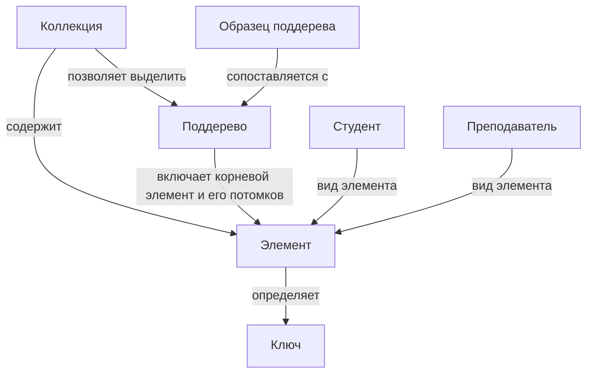
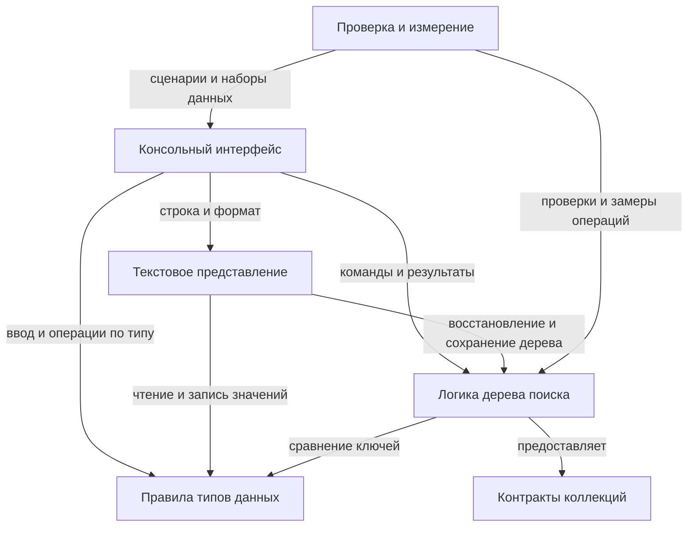

# Дизайн лабораторной работы № 1 «Деревья»

**Дисциплина:** информатика, 3-й семестр  
**Вариант:** бинарное дерево поиска с обычным режимом и AVL-балансировкой

## 1. Постановка задачи

### 1.1. Что делается в работе

Разработать абстрактный тип данных для хранения и обработки коллекции с упорядочиваемыми ключами. Коллекция представляется бинарным деревом поиска. Пользователь выбирает обычный режим или режим AVL и работает с деревом через консоль. В обоих режимах доступны один и тот же набор операций и одинаковые правила сравнения ключей. Режим определяет, поддерживается ли баланс после изменений.

По условиям работы решение предназначено для C++ и опирается на динамическое дерево со ссылками между элементами. Единый набор операций должен работать с каждым предусмотренным типом данных через правила сравнения его ключей.

На вход поступают элементы одного выбранного типа, текстовое описание дерева или параметры генерации. Пользователь задаёт операцию и нужные для неё параметры, например ключ, индекс, порядок обхода или формат. Результатом может быть найденный элемент, признак вхождения, новое дерево, последовательность обхода, значение свёртки или текстовое представление дерева. Для сравнения режимов предусмотрены замеры времени на одинаковых входных данных.

| Пункт методички | Содержание                                                          | Рейтинг |
| --------------- | ------------------------------------------------------------------- | ------: |
| 1               | Бинарное дерево поиска. Вставка, поиск и удаление                   |       5 |
| 1.1             | Балансировка дерева                                                 |       2 |
| 1.2             | Преобразование, фильтрация и свёртка (map, where, reduce)           |       3 |
| 1.3.2           | Прошивка в порядке обхода, заданном параметром                      |       4 |
| 1.4.2           | Сохранение дерева по строке формата                                 |       3 |
| 1.5.2           | Чтение дерева по строке формата                                     |       4 |
| 1.6             | Извлечение поддерева по заданному корню                             |       2 |
| 1.7             | Проверка вхождения поддерева                                        |       3 |
| 7.1             | Интерфейс коллекции ICollection                                     |       2 |
| 7.2             | Интерфейс перечисления IEnumerable и итератор дерева TreeEnumerator |       3 |
| 7.3             | Перегрузка операторов для операций над деревьями                    |       2 |
|                 | **Суммарный рейтинг выбранных пунктов**                             |  **33** |

### 1.2. Зачем нужна программа

Дерево поиска подходит для задач, в которых состав коллекции меняется, а данные нужно находить по ключу и получать в порядке возрастания. Например, в учебной картотеке можно найти полную запись студента по идентификатору, вывести записи в порядке идентификаторов или сформировать выборку по году рождения. Тот же набор операций применим к числам и строкам, когда требуется быстро проверять наличие значения и обходить коллекцию по порядку.

Два режима позволяют сравнить влияние балансировки на высоту дерева и скорость операций при разных порядках поступления одних и тех же ключей. Строковое представление позволяет повторить опыт на конкретной форме дерева и обмениваться примерами.

## 2. Сущности прикладной задачи

### 2.1. Сущности и их описание

| Сущность | Описание |
|---|---|
| Коллекция | Набор элементов одного типа. В рамках одной коллекции каждому ключу соответствует не более одного элемента. У коллекции может не быть элементов |
| Элемент | Целое, вещественное или комплексное число, строка либо запись о студенте или преподавателе |
| Ключ | Признак, по которому определяется место элемента в порядке коллекции и выполняется поиск. У чисел и строк ключом служит само значение, у записей о людях — идентификатор |
| Студент | Запись с идентификатором, фамилией, именем, годом рождения и обозначением учебной группы |
| Преподаватель | Запись с идентификатором, фамилией, именем, годом рождения и обозначением кафедры |
| Поддерево | Часть организованной коллекции, включающая заданный корневой элемент и всех его потомков |
| Образец поддерева | Отдельно заданное поддерево, по которому проверяется вхождение. В образце значимы ключи и расположение элементов |

Целые и вещественные ключи сравниваются по числовому значению, строки — лексикографически. Комплексный ключ сравнивается сначала по действительной части, затем по мнимой. Ключи с равными модулями и разными частями различаются. Пустая строка и строка из пробелов являются допустимыми ключами. Вещественные значения и обе части комплексного числа должны быть конечными. Идентификатор записи — неотрицательное целое число. В текстовом вводе год рождения должен находиться в диапазоне от 1900 до 2100 включительно, а фамилия, имя и обозначение группы или кафедры задаются отдельными полями без пробелов.

Две записи одного типа с одинаковым идентификатором считаются одним ключом даже при различии остальных полей. Поиск по этому идентификатору возвращает сохранённую запись целиком.

### 2.2. Связи между сущностями

В непустой коллекции один элемент занимает положение корня. У каждого элемента может быть левый и правый потомок. Все ключи левого поддерева меньше ключа корневого элемента этого поддерева, а все ключи правого — больше. Извлечение поддерева создаёт отдельную коллекцию, которую можно изменять независимо от исходной.

## 3. Архитектура

### 3.1. Высокоуровневые компоненты

| Компонент | Ответственность |
|---|---|
| Консольный интерфейс | Выбор типа и режима, получение данных и команд, показ результатов и объяснение ошибок |
| Логика дерева поиска | Поддержание состава и структуры дерева, выполнение операций, обходов и проверок |
| Текстовое представление | Описание и проверка строкового формата, перевод дерева в строку и восстановление из строки |
| Правила типов данных | Порядок ключей, проверка значений, доступные преобразования, фильтры и свёртки для каждого типа |
| Общие контракты коллекций | Получение количества и элемента по индексу, последовательное перечисление элементов |
| Проверка и измерение | Проверка функциональных требований, подготовка экспериментальных данных, замер времени и построение графиков |

### 3.2. Связи между компонентами

Консоль передаёт параметры выбранной операции и показывает результат. Правила типа задают смысл сравнения и допустимость значений. Операции над формой дерева сосредоточены в логике дерева поиска. Компонент проверки обращается к дереву напрямую при замерах и использует консоль для проверки пользовательских сценариев.

### 3.3. Ключевые алгоритмы, структуры данных и проектные решения

**Организация дерева.** Для хранения используется бинарное дерево поиска. На каждом шаге поиска или вставки сравнение с текущим ключом определяет, в какое поддерево нужно спуститься. При удалении лист исключается, единственный потомок занимает место удалённого элемента, а при двух потомках это место занимает преемник — наименьший ключ правого поддерева. Для каждого поддерева учитываются его высота и число элементов. Число элементов слева позволяет определить позицию текущего ключа в порядке возрастания и выбрать нужную ветвь при доступе по индексу.

В режиме AVL после успешной вставки или удаления проверяется разность высот левой и правой ветвей на пути изменения. Если модуль разности превысил единицу, для восстановления баланса выполняются одинарные или двойные повороты. Повороты сохраняют порядок ключей. Операции по одному ключу и доступ по индексу требуют прохода не длиннее высоты дерева. Для AVL высота растёт логарифмически. Обычное дерево при монотонной вставке может получить высоту, равную числу элементов.

**Обход, перечисление и прошивка.** В каждом узле выбирается порядок трёх действий — посетить корень, обойти левое поддерево и обойти правое. Поддерживаются все шесть перестановок. Симметричный обход ЛКП выдаёт ключи по возрастанию и служит порядком перечисления по умолчанию. Прошивка задаёт связь «следующий элемент» в выбранном обходе. После построения прошивки полный проход требует линейного времени, а шаг к следующему элементу — постоянного. Успешная вставка или удаление делают прежнюю прошивку недействительной. Повторная вставка имеющегося ключа и попытка удалить отсутствующий ключ сохраняют её.

**Преобразование, фильтрация и свёртка.** Map применяет функцию к каждому элементу и составляет новое дерево по порядку ключей результата. Совпавшие ключи хранятся один раз. Where отбирает элементы по условию и составляет новое дерево. Обе операции сохраняют исходную коллекцию и используют её режим для нового дерева. Reduce последовательно применяет правило к текущему элементу и накопленному результату в выбранном порядке. Для пустого дерева общая свёртка возвращает начальное значение. Для суммы и среднего вещественных чисел промежуточные результаты сохраняют вклад каждого конечного слагаемого. Округление выполняется при получении итогового значения. Для комплексных чисел предусмотрены сопряжение, смена знака и умножение на мнимую единицу. Фильтр может отбирать значения по мнимой части или по диапазону ключей. В комплексной сумме отдельно накапливаются действительные и мнимые части.

**Поддеревья и сравнение.** Для извлечения поддерева сначала ищется его корень по ключу, затем копируются все потомки с сохранением левых и правых связей. Для проверки вхождения по ключу корня образца находится единственный возможный кандидат. Затем сравниваются ключи и форма, включая расположение пустых ветвей. Пустой образец считается входящим в любое дерево. Равенство коллекций определяется набором ключей. Совпадение формы проверяется отдельно. Слияние объединяет ключи двух деревьев и оставляет уже существующую запись при совпадении ключа.

**Строковое представление.** Формат состоит из трёх групп. К обозначает корень, Л — левое поддерево, П — правое. Допускаются также латинские обозначения N, L и R. Каждая роль встречается ровно один раз. Порядок групп задаёт обход, а символы по сторонам группы задают её границы. Например, в формате `{К}(Л)[П]` дерево с корнем 5 и потомками 3 и 8 записывается как `{5}({3}()[])[{8}()[]]`. Пустое поддерево представляется пустой группой. Пустое дерево представляется пустой строкой. Комплексное число вводится и сохраняется как пара (a,b) с действительной частью a и мнимой частью b. В формате по умолчанию один такой ключ выглядит, например, как {(-2,3)}()[].

Закрывающий разделитель значения и обратная косая черта внутри значения экранируются. Если конец группы поддерева совпадает с началом записи узла, обратная косая черта перед непустым поддеревом отличает его от пустой группы. При чтении проверяются формат, допустимость значений, уникальность ключей и порядок поиска во всём дереве. Обычный режим восстанавливает заданную форму. В режиме AVL сохраняются ключи и их значения, а балансировка может изменить форму.

## 4. Функциональные требования

### 4.1. Требования к отдельным компонентам

| Компонент или операция | Действие | Особые случаи и ожидаемое поведение |
|---|---|---|
| Консольный интерфейс | Позволить выбрать тип и режим, ввести элемент вручную, заполнить дерево автоматически или прочитать его из строки | При генерации задаются количество и порядок входа. Поддерживаются случайный, возрастающий и убывающий порядки. Для монотонной генерации в обычном режиме допускается меньший предел объёма. Неверный ввод сопровождается пояснением и возможностью повторить ввод |
| Правила значений | Проверять числовой ввод и поля записей. При поиске записи принимать её идентификатор | Неконечное вещественное число, неконечная часть комплексного числа и отрицательный идентификатор отклоняются. Пустой строковый ключ и строка из пробелов принимаются как введённые значения |
| Вставка и удаление | Вставить элемент, удалить по ключу или очистить дерево | Повторный ключ сохраняет имеющуюся запись. Удаление отсутствующего ключа не меняет дерево. Очистка даёт пустую коллекцию |
| Поиск и границы | Проверить наличие, показать найденное значение, минимум и максимум | Отсутствующий ключ и запрос минимума или максимума у пустого дерева дают понятное сообщение |
| Доступ и перечисление | Предоставить количество элементов, получение элемента по индексу, поиск позиции ключа и перечисление в порядке возрастания | Индексация начинается с нуля. Индекс за границами отклоняется. Для отсутствующего ключа позиция не выдаётся. Пустая коллекция перечисляется без элементов |
| Обход и прошивка | Выполнить один из шести обходов, построить прошивку по выбранному порядку и пройти по ней целиком или с заданного ключа | Проход с ключа включает сам заданный элемент. При отсутствии ключа, отсутствии прошивки или после изменения, сделавшего её недействительной, выдаётся сообщение. Для повторного прохода по недействительной прошивке её строят заново |
| Map, Where и Reduce | Преобразовать элементы, отобрать элементы по условию или вычислить свёртку. Для преобразования и фильтрации показать новую коллекцию и дать выбор, сделать ли её текущей | Результаты Map с одинаковым ключом объединяются. Where может дать пустое дерево. Диапазон фильтра включает границы, обратный диапазон отклоняется. Среднее пустого дерева не определено. Если итог свёртки выходит за допустимый диапазон выбранного числового типа, интерфейс сообщает об ошибке |
| Строковый обмен | Сохранить дерево по указанному формату и загрузить строку в выбранном формате | По умолчанию используется `{К}(Л)[П]`. При ошибке формата или строки интерфейс сообщает причину. Текущее дерево заменяется только после успешного чтения. Пустая строка дерева загружает пустое дерево |
| Поддеревья | Извлечь поддерево по корню и проверить наличие поддерева по образцу | Для отсутствующего корня извлечение сообщает об ошибке. Образец проверяется с заданной пользователем формой. Копия поддерева независима от исходного дерева |
| Операции над деревьями | Выполнять добавление и удаление элемента, слияние и объединение деревьев, сравнение наборов ключей и вывод элементов через перегруженные операции | Слияние пропускает повторы. Объединение с получением нового дерева сохраняет оба исходных дерева. Совпадение наборов ключей допускает разные формы |
| Представление состояния | Показывать режим, количество элементов, высоту, состояние прошивки, результаты операций и структуру дерева | Если полный рисунок или перечень слишком велик для удобного показа, интерфейс сообщает об ограничении вывода. Пользователь может запросить проверку порядка, высот, размеров и, в режиме AVL, баланса |

### 4.2. Требования ко всей системе

1. **Создание и работа с деревом.** Пользователь выбирает тип и режим, вводит или генерирует данные, выполняет операции и видит итоговое состояние. Ошибочные параметры, которые обнаруживаются до изменения дерева, отклоняются без потери текущих данных.
2. **Повторение опыта.** Пользователь может сохранить сформированное дерево в заданном формате и загрузить полученную строку. Повторная загрузка в обычном режиме сохраняет ключи, значения и форму. В режиме AVL после загрузки сохраняются ключи и значения, а дерево удовлетворяет условию баланса.
3. **Сравнение режимов.** Для одинаковых последовательностей ключей выполняются замеры обычного дерева и AVL. Возрастающий, убывающий и перемешанный порядок рассматриваются отдельно. Время операций измеряется отдельно от подготовки входных данных. Результаты представляются графиками зависимости времени от числа элементов для больших (10⁴10⁵ элементов) и очень больших (10⁶-10⁸ элементов) наборов. На монотонном входе для обычного дерева допускается отдельный предел из-за квадратичного времени построения.
4. **Проверяемость.** Основные операции проверяются модульными тестами. Сценарии консольного ввода и вывода проверяются на обычных, ошибочных и пограничных данных.

### 4.3. Критерии проверки

| Сценарий | Ожидаемый результат |
|---|---|
| Вставить `1, 2, 3, 4, 5` в оба режима | Оба дерева дают `1, 2, 3, 4, 5` при ЛКП. Высота обычного дерева равна 5. В AVL разность высот ветвей каждого узла не превышает единицы |
| Найти и удалить ключ из дерева, затем повторить удаление | Сначала возвращается сохранённое значение, затем ключ исчезает. Повторное удаление оставляет состояние прежним |
| Прошить дерево, вставить новый ключ, запросить обход по прежней прошивке | Интерфейс сообщает, что нужна новая прошивка. После её построения обход соответствует выбранному порядку |
| Сохранить и загрузить дерево с корнем 5 и потомками 3 и 8 в формате `(Л){К}[П]` | В обычном режиме восстанавливаются те же ключи и форма. Строка, помещающая 8 в левое поддерево 5, отклоняется |
| Извлечь поддерево и изменить копию. Сравнить с образцом, у которого те же ключи, но другая форма | Исходное дерево сохраняет своё состояние. Образец с другой формой не считается вхождением |
| Вставить, найти и удалить ключи, состоящие из пустой строки и строки из пробелов | Каждый ключ принимается и обрабатывается отдельно, включая сохранение пробелов |
| Вычислить среднее ключей `-1e308, 3, 1e308` и сумму ключей `-1.7e308, -1.6e308, 1.7e308` | Среднее равно 1. Сумма равна −1.6e308. Если вне диапазона находится сам результат, интерфейс сообщает об этом |
| Вставить комплексные ключи (1,2), (0,1), (1,-2), сохранить и загрузить дерево | Обход ЛКП даёт (0,1), (1,-2), (1,2). Ключи (1,-2) и (1,2) сохраняются отдельно, хотя их модули равны. Сумма равна (2,1) |
| Запустить сравнение режимов на одинаковом наборе в разных порядках | Замеры содержат размер входа, режим, порядок входных данных там, где он меняется, и время операции. По результатам строятся графики |
